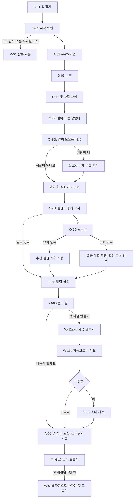
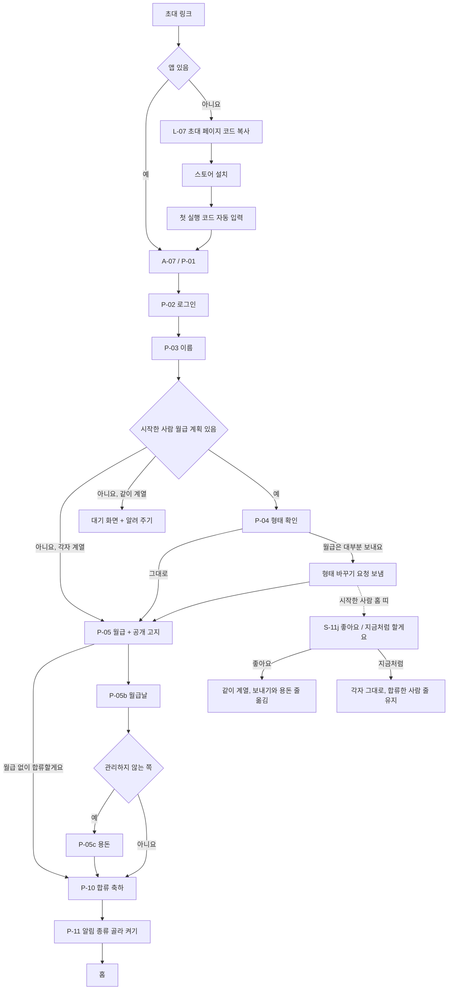
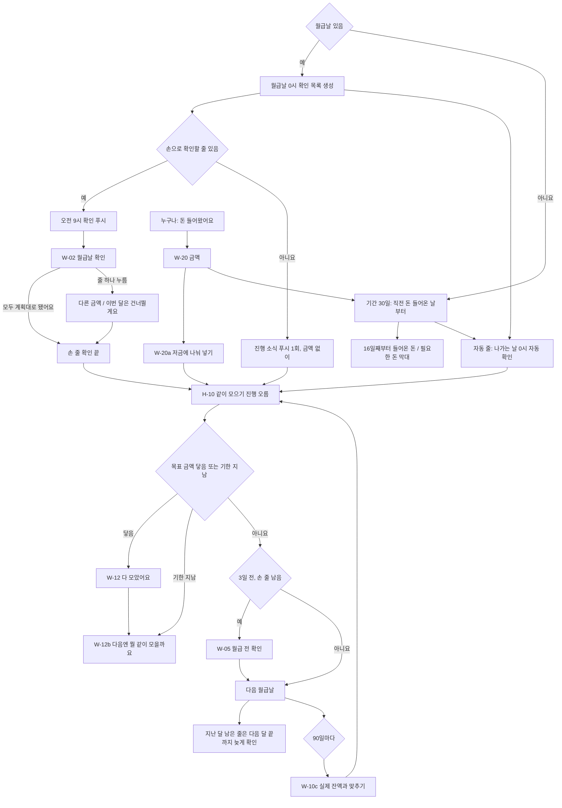
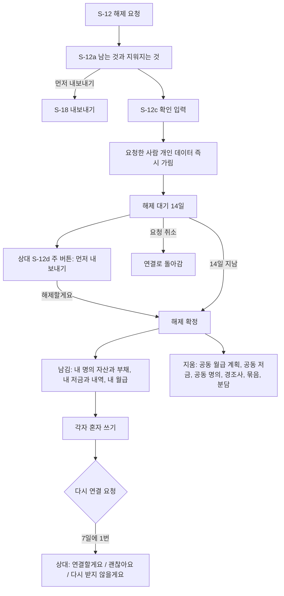

# 유저 플로우

주요 사용자별 경로. 규칙은 → 핵심 규칙, 화면 상세는 → 화면 설계. 결정 이유 → `docs/adr/0003-replan-goal-checklist.md`, `docs/adr/0007-goal-into-saving-line.md`, 2026-11-13 같이 모으기·확인 한 번 → `docs/adr/0009-save-together-plan.md`.

## 1. 전체 흐름

2026-11-13 v2.2: 가입 → 온보딩(이름 O-03, 두 사람 사이 O-11, 같이 쓰는 생활비 O-30, 같이 모으는 저금 O-30b, (누가 관리 O-30c), 월급 O-31, 월급날 O-32, 알림 허용 O-55, 준비 끝 O-60) → 첫 저금(W-11a~e) → (미합류면 초대 O-07) → 앱 잠금 권장 A-06(건너뛸 수 있음) → 홈(H-10 같이 모으기). 매달은 월급날에 한 번 “모두 계획대로 됐어요”, 자동 줄은 나가는 날 앱이 확인 → 저금이 쌓임 → 손 줄이 남았을 때만 다음 월급날 3일 전 확인. 월급날이 없는 사람은 “돈 들어왔어요”와 기간 막대. 고치는 건 언제든 바로, 파트너에게는 알림(예외 둘: 관리 형태 합치기, 분담 제안). 그림 → 3장. 2장 표와 3장이 다르면 3장이 정본.

## 2. 시나리오

| # | 시나리오 | 경로 | 화면 수·시간 (추정) | 관련 규칙 |
| --- | --- | --- | --- | --- |
| 1 | 찬우: 맞벌이 신혼, 설치~첫 저금(휴대폰·태블릿 앱, 2026-11-13) | A-01 → O-01 → A-02 → A-03 → (A-04) → A-05 → O-03 → O-11 → O-30 → O-30b → (O-30c) → O-31 → O-32 → O-55 → O-60 → W-11a~e → (O-07 초대 시트) → A-06(‘나중에 할게요’ 가능) → 홈 H-10. 첫 확인은 다음 월급날 W-02 | 약 3분 이하·질문 8~9화면 + 첫 저금 | → 핵심 규칙 › 월 사이클 |
| 2 | 소셜 로그인, 브라우저 로그인(재방문·새 기기) | A-01 → A-02 → A-03(시스템 로그인 창 → 앱으로 복귀) → (이 기기에 PIN이 없으면 A-06) → 홈 | 2~4화면·1분 | → 보안·개인정보 2장 ‘로그인’ |
| 3 | 예비부부 | 1번과 같음. O-11 ‘결혼 준비 중이에요’ → 첫 저금 이름 칩 맨 앞 ‘결혼 비용’(2026-11-13), 홈 H-10 “결혼식 D-n”(예정일은 S-11h), H-12 결혼 준비 타일 → W-14 쓸 곳 메모(잔금 ‘냈어요’), 각자 계열이면 W-15 묶음 | 약 1분·질문 6화면 + 준비 끝 | → 온보딩 ① |
| 4 | 예빈: 휴대폰으로 받은 초대 링크로 합류(모바일 앱) | 링크 → 앱이 있으면 A-07(P-01), 없으면 L-07(코드 복사) → 스토어 → 설치 → 첫 실행 코드 자동 입력(2026-11-13) → P-01 → A-02 → A-03 → (A-04) → A-05 → P-03 이름 → P-04 형태 확인 → P-05 월급(각자 계열이면 ‘월급 없이 합류할게요’) → P-05b 월급날 → (P-05c 용돈, 관리하지 않는 쪽) → P-10 → P-11 알림 종류 → 홈 | 약 7화면·1~2분 | → 파트너 합류 |
| 5 | 혼자 쓰던 예빈이 초대받아 합류(기록 옮기기) | A-07 → P-01 → P-02a → P 화면 | +1~2화면 | → 파트너 합류 |
| 6 | 한 달 사이클 | 월급날 알림(손 줄이 있을 때만, 아니면 진행 소식) → W-02 “모두 계획대로 됐어요” 한 번(다른 줄만 고침) → 자동 줄은 나가는 날 자동 확인 → (다음 월급날 3일 전, 손 줄이 남았으면) W-05. 상여 등은 “돈 들어왔어요” W-20 → W-20a | 확인 30초 | → 핵심 규칙 › 월 사이클 |
| 7 | 덜 적극적인 예빈(모바일 앱만 사용) | 한 사람 관리형이면 ‘보내기’ + ‘용돈’이 자동 줄이라 매달 할 일 없음, 위젯·경조사 알림만(2026-11-13). 각자 계열이면 월급날 푸시 → W-02 한 번 확인. 찬우는 예빈 것을 공개 단계대로 보기만 | 매달 0~30초 | → 월급 체크리스트 |
| 8 | 월급 계획 고치기 | 홈 월급 계획 타일(H-07, 2026-11-09) → 월급 탭 ‘계획’ W-01 영수증 → 줄을 눌러 금액 시트 ‘확인’(줄마다 바로 적용, 파트너 알림은 묶어서, 되돌리기) | 1화면·30초 | → 월급 체크리스트 |
| 9 | 저금 항목 추가·달성 | 월급 탭 저금 묶음 ‘+ 저금 추가’(2026-11-09 + 버튼 대신) → W-11a 이름 → W-11b 매달 금액 → W-11e 자동으로 나가요?(2026-11-13) → W-11c 목표 금액(선택) → W-11d 기한(선택) → 내 월급 계획(합쳐서면 공동)에 1줄 → 매달 체크 → W-12 달성 축하 → W-12a ‘계속 모을게요’ / ‘그만할게요’ / ‘목표 금액을 새로 정할게요’(→ 새 목표 금액 → 기한) → W-12b 다음 저금(2026-11-13) | 5화면·1분 | → 월급 탭 |
| 10 | 자산 관리 처음 적기 | 홈 자산 관리 타일(H-04) → F-01 묶음 타일 → F-03 → 순자산 표시 | 항목당 1화면·20초 | → 자산 관리 |
| 11 | 경조사 기록 | 캘린더(Y-01) → 경조사 추가(생일, 기념일, 사귄 날, 명절, 가족 행사 모두 같은 종류, 2026-11-13 ‘양가 행사’ → ‘가족 행사’) | 1~2화면·30초 | → 캘린더 |
| 12 | 연결 해제 | S-12 → S-12a(지워지는 것 안내, 필요하면 ‘먼저 내보내기’ → S-18) → S-12c “연결 해제” 입력 후 요청 → 상대에게 알림 → 상대 S-12d ‘확인했어요’ 또는 14일 지남 → 확정(2026-11-13): 같이 쓰던 것만 지움, 내 명의·내 저금·내 월급 계획은 남음 → S-12h → 홈 또는 O-30(3-4) | 요청 2화면·1분 | → 핵심 규칙 › 커플·권한 |
| 13 | 연결 해제 요청 취소 | S-12 ‘연결 해제 대기 중’ → ‘요청 취소’(요청자만, 확정 전) | 1화면·10초 | → 핵심 규칙 › 커플·권한 |
| 14 | 계정 삭제 | S-10 → S-18 ‘계정 삭제’ → (구독 중이면 해지 안내) → S-18b 확인 Modal → 로그아웃. 30일 안 다시 로그인하면 “계정 삭제를 취소할까요?” → 복구하면 내 혼자 공간으로 돌아오고 연결은 새 요청으로(15번, 2026-11-13), 상대에게 ‘계정 복구’ 알림 | 2~3화면·1분 | → 보안·개인정보 3장 ‘계정 삭제’ |
| 15 | 해제 뒤 다시 연결(2026-11-13) | S-12 “다시 연결하기”(7일에 1번) → 상대 S-12g ‘연결할게요’ / ‘괜찮아요’ / “다시 받지 않을게요” → 공개 범위 한 번 확인(S-13) → 홈. 복구 없음(30일 복구는 출시 후) | 3화면·1분 | → 핵심 규칙 › 커플·권한 8장 |
| 16 | 지운 항목 되살리기 | 항목 ⋯ → 휴지통으로 보내기(바로) → Toast “되돌리기” 6초 / 지나면 설정 › 휴지통 → 되살리기 또는 영구 삭제(Modal). 30일 후 자동 영구 삭제 | 1~2화면·30초 | → 화면 설계 › 설정 ‘휴지통’ |
| 17 | 오프라인(앱) | 연결 끊김 → 회색 안내 띠 “오프라인” + “마지막 저장 {시각}” → 마지막 데이터로 볼 수만 있음, 저장·체크 등을 누르면 “인터넷에 연결되면 할 수 있어요” → 다시 연결되면 새로 받음 | 추가 화면 없음 | → 기술·운영 › 동기화, 화면 설계 › 공통 상태 |
| 18 | 휴대폰에서 처음 시작 | L-01 ‘휴대폰 앱 받기’(스토어) → 설치 → A-01 → O-01 → A-02 → A-03 → (A-04) → A-05 → O-03~O-60 → 첫 저금 → A-06(선택) → 홈. 같은 계정으로 태블릿 앱에도 로그인해 이어 씀(2026-11-10 데스크톱 앱 없앰, ADR 0008) | 약 2분·10화면 | → 제품 개요 5장 |
| 19 | 날짜 없는 프리랜서(2026-11-13) | O-32 ‘날짜가 정해져 있지 않아요’ → 확인 목록 없음 → 돈 들어올 때마다 W-20 → W-20a → 홈 H-13 기간 막대(16일째부터 들어온 돈 / 필요한 돈) | 1분 | → 07 6장 |
| 20 | 생활비 통장 나누기(2026-11-13) | 홈 띠 8번 또는 W-01 “+ 같이 쓰는 통장” → W-01b → 상대 홈 띠 4번 → W-01c ‘좋아요’ | 2~3화면·1분 | → 08 4-1 |
| 21 | 육아휴직 월급 넣기(2026-11-13) | S-11c 금액 → “언제부터” + “언제까지” → 그 달 홈 띠 6번 → W-01 다시 맞추기 | 3화면·1분 | → 07 5장 |
| 22 | 석 달 뒤 잔액 맞추기(2026-11-13) | 홈 띠 12번 → W-10c 저금마다 실제 금액 → ‘맞추기’ | 1화면·2분 | → 06 4-2 |

## 3. v2.2 흐름 그림 (2026-11-13)

### 3-1. 첫 사용: 가입 → 온보딩 → 첫 저금 → 초대

### 3-2. 합류: 일반 / 한 사람 관리형 / 월급 없이

### 3-3. 매달: 확인 → 같이 모으기 진행 → 월급 전 확인

### 3-4. 연결 해제

